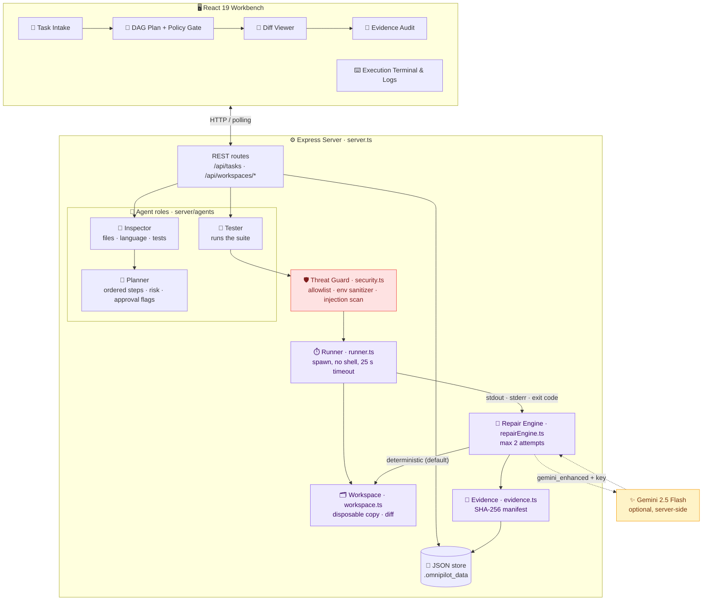
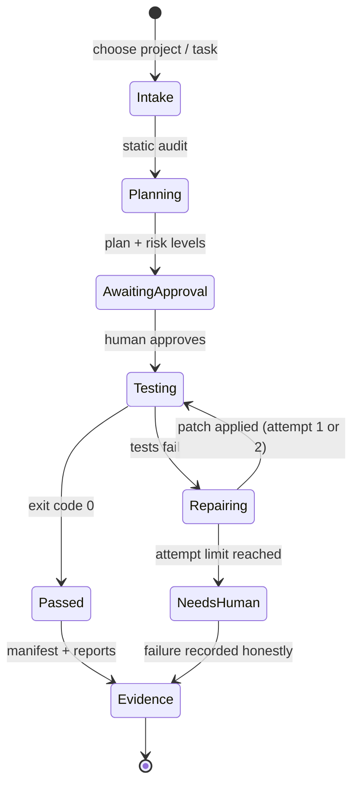
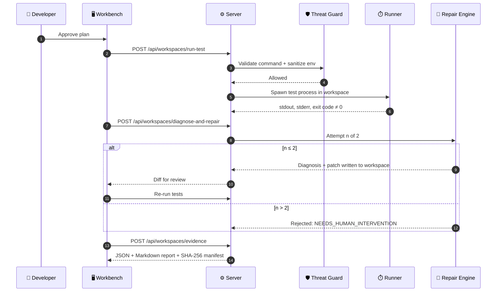

<div align="center">

<br/>

# 🛰️ OmniPilot X

### Autonomous Software Engineering Workbench

**Sandboxed test runs · Bounded self-repair · Human approval gate · Verifiable evidence reports**

<br/>

<a href="https://omnipilot-ai-nzts.vercel.app/">
  
</a>

<br/><br/>


<br/>

**[🌐 Live Demo](https://omnipilot-ai-nzts.vercel.app/)** &nbsp;│&nbsp;
**[✨ Highlights](#-highlights)** &nbsp;│&nbsp;
**[🏗️ Architecture](#️-architecture)** &nbsp;│&nbsp;
**[🛡️ Security](#️-security-model)** &nbsp;│&nbsp;
**[🚀 Quick Start](#-quick-start)** &nbsp;│&nbsp;
**[📡 API](#-api-reference)** &nbsp;│&nbsp;
**[🗺️ Roadmap](#️-roadmap)**

<br/>

> Built for the **OmniRush Agentic Buildathon 2026**.
> An agent you can audit: it runs tests in a disposable workspace, repairs **at most twice**, waits for your approval and never calls a change "successful" unless the tests say so.

<br/>

</div>

---

<div align="center">

## 📖 Overview

</div>

<div align="center">

**OmniPilot X** takes a software task, inspects the repository, builds a dependency-aware plan, runs the test suite in an **isolated copy of the project**, diagnoses failures, applies a **bounded repair**, re-runs the tests and produces a **hash-stamped evidence report**.
It works fully **offline and deterministically by default**, with optional **Gemini** assistance when an API key is present.

</div>

<br/>

<div align="center">

| 🔒 Isolated | ♻️ Bounded | 🧑‍⚖️ Gated | 🧾 Verifiable |
|:---:|:---:|:---:|:---:|
| Every run happens in a disposable workspace copy | Hard cap of **2 repair attempts**, then a human is asked | Staged changes need explicit approval | SHA-256 manifest, JSON and Markdown reports, unified patch |

</div>

---

<div align="center">

## ✨ Highlights

</div>

<div align="center">

| | Capability | Details |
|:---:|:---|:---|
| 🗂️ | **Disposable workspaces** | Each session copies the project into `.omnipilot_workspaces/<session-id>/`; the original is never modified |
| ⏱️ | **Sandboxed test runner** | `child_process.spawn` with `shell: false`, sanitized environment, working directory pinned to the workspace and a **25 s** timeout (SIGTERM, then SIGKILL) |
| 🛡️ | **Threat guard** | Command allowlist, secret stripping, prompt-injection scanner, path-traversal checks |
| 🔁 | **Bounded self-repair** | Diagnose from stdout/stderr, patch, re-test; halts with `NEEDS_HUMAN_INTERVENTION` after attempt 2 |
| 🧑‍⚖️ | **Human approval gate** | Plan and diff review before changes are authorized |
| 🧾 | **Evidence reports** | JSON audit, Markdown PR summary and a SHA-256 manifest hash |
| 🧠 | **Dual engine** | Deterministic offline engine (default) or Gemini 2.5 Flash when `GEMINI_API_KEY` is set |
| 📊 | **Rich workbench UI** | DAG plan view, diff viewer, execution terminal, project health radar, agent runs, logs, repo explorer, multi-agent studio, workflow canvas |
| ⌨️ | **Power-user UX** | Command palette and keyboard shortcuts (`Ctrl/⌘ + Enter` to advance a stage, `?` for the cheat-sheet) |
| 🐳 | **Docker + CI** | Dockerfile, docker-compose and a GitHub Actions pipeline (lint, test, build) |

</div>

---

<div align="center">

## 🏗️ Architecture

</div>



<div align="center">

### 🔄 Autonomous Workflow

</div>



<div align="center">

### 📨 One Repair Cycle

</div>



---

<div align="center">

## 🛡️ Security Model

</div>

<div align="center">

| Threat | Mitigation | Covered by |
|:---|:---|:---|
| **Prompt injection** | Scans task text and repo comments for override patterns such as "ignore previous instructions" | `tests/security.test.ts` |
| **Credential leakage** | Strips API keys, cloud tokens and SSH agent variables from the child-process environment | `tests/security.test.ts` |
| **Arbitrary command execution** | Strict allowlist (`npm test`, `node --test`, `npx vitest run`, `git status/diff/log`); rejects chaining, pipes and subshells; spawned with `shell: false` | `tests/security.test.ts` |
| **Path traversal** | Paths resolved against the workspace boundary; `../` and sensitive files rejected | `tests/security.test.ts` |
| **Runaway loops and cost** | At most 2 repair attempts and a 25 s process ceiling | `tests/repairEngine.test.ts` |

</div>

> **Scope note:** isolation is **process-level** (copied workspace, allowlist, sanitized env, timeouts). It is not an OS-level container or VM sandbox, so run OmniPilot X on code you trust or inside the provided Docker image.

---

<div align="center">

## 🧰 Tech Stack

</div>

<div align="center">

| Layer | Technology |
|:---:|:---|
| 🎨 **Frontend** | React 19 · TypeScript · Vite 8 · Tailwind CSS 4 · Motion · Lucide Icons |
| ⚙️ **Server** | Node.js 22 · Express 4 · `tsx` · dotenv |
| ✨ **AI (optional)** | Google Gen AI SDK, Gemini 2.5 Flash, server-side only |
| 🧪 **Testing** | Node's built-in test runner via `tsx --test` · 9 tests |
| 📦 **Packaging** | Dockerfile · docker-compose · GitHub Actions CI |
| ☁️ **Hosting** | Vercel (frontend build) |

</div>

---

<div align="center">

## 🚀 Quick Start

**Prerequisites:** Node.js 22+ · npm 10+ · Git

</div>

```bash
git clone https://github.com/sathi2305/Omnipilot-Ai.git
cd Omnipilot-Ai

npm install
cp .env.example .env        # optional: add GEMINI_API_KEY for Gemini mode
npm test                    # 9 tests
npm run dev                 # → http://localhost:3000
```

<details>
<summary><b>🐳 Docker</b></summary>

```bash
docker build -t omnipilot-x:latest .
docker run -p 3000:3000 omnipilot-x:latest
# or
docker-compose up --build
```

</details>

<details>
<summary><b>📜 Scripts</b></summary>

| Command | What it does |
|:---|:---|
| `npm run dev` / `npm start` | Express server with Vite middleware |
| `npm run build` | Production frontend build |
| `npm test` | Security, repair-bound and evidence tests |
| `npm run lint` | Type-check (`tsc --noEmit`) |

</details>

<details>
<summary><b>🎬 Demo walkthrough (bundled fixture)</b></summary>

1. **Intake:** load the bundled `data-kit-ts` fixture and review the static audit.
2. **Plan:** the planner produces an ordered, risk-labelled plan.
3. **Baseline run:** execute the tests and see 2 reproducible failures in `chunk()`.
4. **Approve:** review the plan and authorize the change.
5. **Repair (attempt 1 of 2):** the engine diagnoses the logs and patches `src/collection.mjs`.
6. **Verify:** re-run; all 5 tests pass with exit code 0.
7. **Evidence:** export the JSON report, Markdown summary and SHA-256 manifest (samples in `examples/`).

</details>

---

<div align="center">

## 📡 API Reference

</div>

<div align="center">

| Group | Endpoints |
|:---|:---|
| **Health & metrics** | `GET /api/health` · `GET /api/system/metrics` · `GET /api/metrics` |
| **Projects & fixtures** | `GET` `POST /api/projects` · `GET /api/fixtures` |
| **Tasks** | `GET` `POST /api/tasks` · `GET /api/tasks/:id` · `POST /api/tasks/:id/plan` · `/approve` · `/cancel` |
| **Task data** | `GET /api/tasks/:id/events` · `/files` · `/file-content` · `/diff` · `/tests` · `/logs` · `/report` |
| **Workspace pipeline** | `POST /api/workspaces/create` · `/inspect` · `/plan` · `/run-test` · `/diagnose-and-repair` · `/diff` · `/evidence` · `/cleanup` |

</div>

Full details live in [`docs/API.md`](docs/API.md), [`docs/ARCHITECTURE.md`](docs/ARCHITECTURE.md), [`docs/SECURITY.md`](docs/SECURITY.md) and [`docs/TESTING.md`](docs/TESTING.md).

---

<div align="center">

## 📁 Project Structure

</div>

```text
Omnipilot-Ai/
├── server.ts                   # Express routes and static hosting
├── server/
│   ├── agents/agentEngine.ts   # inspector, planner, tester agents
│   ├── repairEngine.ts         # diagnosis + bounded repair (max 2)
│   ├── runner.ts               # sandboxed subprocess execution
│   ├── workspace.ts            # disposable workspace + diff
│   ├── security.ts             # allowlist, env sanitizer, injection scan
│   ├── evidence.ts             # SHA-256 manifest + reports
│   └── database.ts             # JSON-file persistence
├── src/                        # React workbench (DAG plan, diff, terminal, radar ...)
├── fixtures/data-kit-ts/       # benchmark project with seeded defects
├── tests/                      # security · repair engine · evidence
├── examples/                   # sample evidence report + patch
├── docs/                       # API · ARCHITECTURE · SECURITY · TESTING
├── Dockerfile · docker-compose.yml · .github/workflows/ci.yml
└── LICENSE                     # Apache-2.0
```

---

<div align="center">

## 🌐 Deployment

**Live now:** [**omnipilot-ai-nzts.vercel.app**](https://omnipilot-ai-nzts.vercel.app/)

</div>

- The Vercel project builds the React workbench (`npm run build` → `dist/`) with an SPA rewrite.
- The test runner, workspaces and evidence pipeline live in the **Express server**, and the repo has no serverless `api/` functions. For the full run-test, repair and evidence flow, run it locally or via Docker, or host `server.ts` on a Node host.

---

<div align="center">

## ⚖️ Scope & Transparency

</div>

| Area | Current state |
|:---|:---|
| **Verified here** | 9/9 tests pass, `tsc --noEmit` is clean and the production build succeeds |
| **Repair engine** | Tuned to the bundled `data-kit-ts` benchmark: it recognizes that fixture's two failure signatures and rewrites `chunk()` in `src/collection.mjs` with a regex replacement (the offline mode does not use an AST). The Gemini prompt is likewise specific to that function. It is a faithful demo of the bounded-repair *workflow*, not yet a general-purpose bug fixer |
| **Workspace copy** | A plain recursive file copy, not filesystem copy-on-write |
| **Isolation** | Process-level hardening (see Security Model), not a container or VM |
| **Evidence hash** | A SHA-256 integrity checksum over the run record; it is not a digital signature |
| **Storage** | Single JSON file (`.omnipilot_data/omnipilot_db.json`); fine for a local workbench |

---

<div align="center">

## 🗺️ Roadmap

</div>

<div align="center">

| Status | Item |
|:---:|:---|
| ✅ | Sandboxed runner, threat guard, 2-attempt repair bound, evidence reports |
| ✅ | Workbench UI with DAG plan, diff viewer, terminal and health radar |
| 🔜 | General failure triage and patch synthesis for arbitrary repositories |
| 🔜 | Serverless or hosted backend so the full flow runs on the live demo |
| 🔜 | Container-level sandbox (rootless Docker or gVisor) per run |
| 🔜 | Signed attestations (for example Sigstore) in place of a plain checksum |
| 💡 | Multi-language fixtures (Python, Go) and PR creation through the GitHub API |
| 💡 | Database-backed history instead of a JSON file |

</div>

---

<div align="center">

## 🤝 Contributing

**Fork** → **Branch** (`feature/your-idea`) → **Commit** → **Push** → **Open a Pull Request**

Run `npm run lint && npm test` before opening a PR.

<br/>

## 📄 License

Released under the **[Apache License 2.0](LICENSE)**.

</div>

---

<div align="center">

## 👨‍💻 Author

**Sathiyamoorthi** · [@sathi2305](https://github.com/sathi2305)

<br/>

<a href="https://omnipilot-ai-nzts.vercel.app/">
  
</a>

<br/><br/>

**⭐ If this project is useful, please star the repo! ⭐**

<sub>Made with ❤️ for the OmniRush Agentic Buildathon 2026</sub>

</div>
